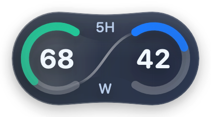

# Pet's Pet

[中文](README.md) | English

A local companion tool that adds a quota widget next to the Codex Desktop pet. The macOS version also shows per-conversation token usage and project folder sizes in the sidebar. The Windows version is a preview with a smaller feature set.

This is an independent, unofficial tool. It is not affiliated with OpenAI.

**[Download for macOS](https://github.com/Marwin-M/pets-pet/releases/download/v1.7.1/PetsPet-1.7.1.zip)** · **[Download Windows x64 preview](https://github.com/Marwin-M/pets-pet/releases/download/v1.6.0/PetsPet-Windows-1.6.0-x64.zip)** · [Report an issue](https://github.com/Marwin-M/pets-pet/issues)

The current macOS release is **1.7.1**. The Windows preview stays on **1.6.0**. Release notes are written in Chinese and live in [`Releases/`](Releases/).

| Light | Dark |
| --- | --- |
|  |  |

Demo values only (5H 66, W 88). They do not reflect a real account.

## macOS features

- **Quota widget next to the pet.** Choose **5H + W remaining** or **reset countdown + W remaining**. By default it adapts to the windows returned by the official service. The menu bar shows the exact reset time.
- **Two placements.** Follow the pet (default; click the pet to collapse or expand the widget), or pin the widget to the bottom of the sidebar. Light, dark, and system appearance are supported.
- **Today's tokens** in the menu bar, summed from local Codex records since midnight in your time zone.
- **Conversation usage blocks** in the sidebar. Hover to see input, cached input, and output.
- **Project folder size** after each project name, measured the same way as Finder's "Size".
- **Startup animation.** Pet's Pet can launch Codex with a built-in or custom splash (HTML, MOV, MP4, or PNG), with separate light and dark variants.
- Missing or failed data is shown as unknown, never as zero.

## Requirements

- macOS build: **Apple Silicon Macs only**. Declared minimum is macOS 13; only macOS 26.5.1 has been tested so far.
- Windows preview: **Windows 10/11 x64** with .NET Framework 4.8. See the [Windows notes](Windows/README.md) (Chinese).
- Codex Desktop must be installed and signed in on both platforms.
- Follow mode needs the pet visible in Codex and, on macOS, Accessibility permission for PetsPet.
- The sidebar features need the local sidebar connection, enabled from the menu.

## Install on macOS

1. Download `PetsPet-1.7.1.zip` from the [1.7.1 release page](https://github.com/Marwin-M/pets-pet/releases/tag/v1.7.1).
2. Unzip it and move `PetsPet.app` to Applications. Quit any older version before upgrading.
3. The app is ad-hoc signed and **not notarized by Apple**. If macOS says it cannot verify the developer, first check the download source and checksum, then follow [Apple's instructions](https://support.apple.com/en-us/102445) to open it from **System Settings → Privacy & Security**. You do not need to disable any system protection.
4. On first launch, allow **PetsPet** in **System Settings → Privacy & Security → Accessibility**. After an upgrade, if the switch is on but the app still says it is not authorized, remove the old entry and add the app again.
5. Show the pet in Codex. The widget appears once Pet's Pet finds it. Use the menu bar icon to check status, change display options, refresh, or quit.

The app has no Dock icon and does not start at login. Quit it from the menu bar.

To verify the download, run `shasum -a 256 PetsPet-1.7.1.zip` and compare the result with `SHA256SUMS.txt` on the same release page.

## Install the Windows preview

1. Download `PetsPet-Windows-1.6.0-x64.zip` from the [1.6.0 release page](https://github.com/Marwin-M/pets-pet/releases/tag/v1.6.0).
2. Unzip it into a folder you can write to (not inside the ZIP, not in `Program Files`) and run `PetsPet.exe`. It is portable and needs no installer.
3. The package is unsigned. Check the source and checksum before running it.

## Sidebar connection (macOS)

The pinned widget, conversation usage, and folder sizes need a local connection to the Codex window. If the status says "not connected", save your work in Codex, then choose **Enable sidebar connection…** from the menu and confirm. Pet's Pet asks Codex to quit normally and reopens it with a local-only debugging port (`127.0.0.1:39222`). If you cancel, Codex refuses to quit, or it times out, Codex is never force-quit.

Do not forward this port to an external network. This feature depends on Codex's internal page structure and may need updates after a Codex release. Follow mode does not use it.

## Data and privacy

- Quota comes from the official App Server bundled with Codex and reuses your existing sign-in. Pet's Pet does not read or store credentials and never starts chats or model tasks.
- Token usage is read from local Codex statistics only. Message content is never extracted or stored. Conversations without local records (for example, cloud tasks) show as unknown.
- Diagnostics are kept in `~/Library/Application Support/PetsPet/`, size-limited, and contain no chat text, account identifiers, or access tokens. The app cannot upload them.
- Pet's Pet does not modify Codex's installation or its default launch behavior.

## Known limitations

- Not notarized by Apple. Only tested on the author's Mac; other macOS and Codex versions have not been verified.
- Multiple displays, overlapping windows, fast dragging, sleep/wake, and the real sidebar connection still need hands-on testing.
- The Windows preview does not yet include today's tokens, conversation usage, folder sizes, or the startup features.

When reporting a problem, please include your OS version, chip, Codex version, and steps to reproduce. Remove personal information from screenshots and logs, and never upload your full conversation database.

## Development (macOS)

Requires macOS, Apple Command Line Tools, and a Swift 6.0 toolchain. No third-party runtime dependencies.

```sh
zsh Scripts/test.sh                                              # core, sidebar and lifecycle checks
python3 -m unittest discover -s Tests -p test_release.py         # release tooling checks
swift build -c release --product PetsPet                         # build only
```

`Scripts/build.sh` packages the app and overwrites `dist/PetsPet.app`. See [`Docs/DEVELOPMENT.md`](Docs/DEVELOPMENT.md) (Chinese) for the full workflow.
