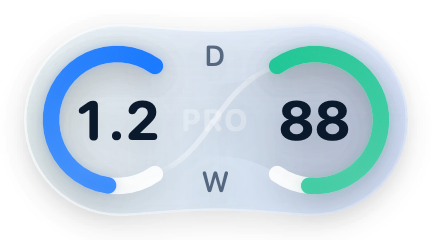
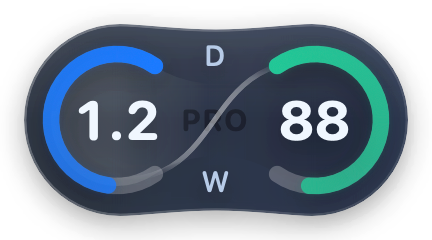
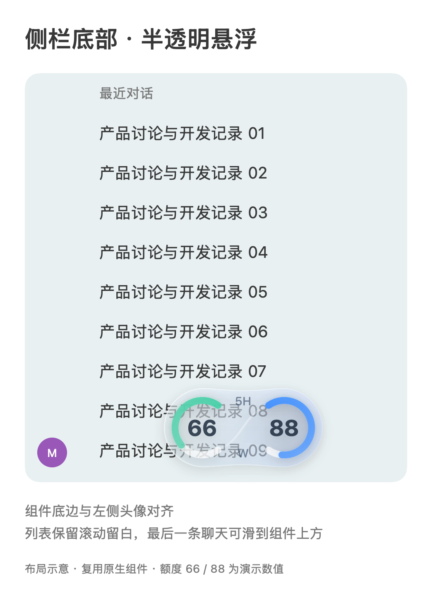
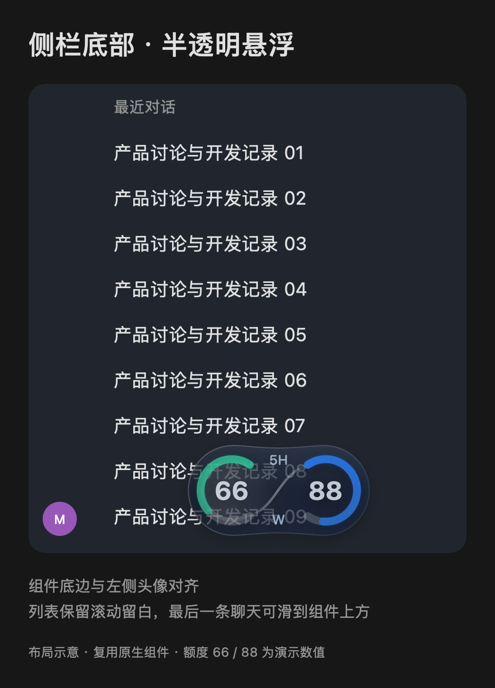

# Pet's Pet

给 Codex Desktop 宠物加额度组件的本地工具。macOS 版还支持侧栏对话用量和项目文件夹大小；Windows 版为功能范围较小的预览版。

这是独立开发的非官方工具，与 OpenAI 无隶属关系。

**[下载 macOS 版](https://github.com/Marwin-M/pets-pet/releases/download/v1.7.1/PetsPet-1.7.1.zip)** · **[下载 Windows x64 预览版](https://github.com/Marwin-M/pets-pet/releases/download/v1.6.0/PetsPet-Windows-1.6.0-x64.zip)** · [1.7.1 更新说明](Releases/1.7.1.md) · [反馈问题](https://github.com/Marwin-M/pets-pet/issues)

macOS 当前公开下载版本为 **1.7.1**，安装包、匹配源码和校验文件见 [1.7.1 下载页](https://github.com/Marwin-M/pets-pet/releases/tag/v1.7.1)。Windows 预览版继续使用 **1.6.0**，从 [Windows 下载页](https://github.com/Marwin-M/pets-pet/releases/tag/v1.6.0) 获取。

**1.7.1（构建 28）**：默认和自定义启动动画支持明暗两套，跟随 Pet’s Pet 外观；新增约 3.8 秒的神圣开屏配乐，音乐自然淡出后画面继续；修复深色标题在部分 Retina 窗口尺寸下的截断字影。旧自定义素材自动保留。修订于 2026-10-28 完成打包，2026-10-30 同步 GitHub；安装包、匹配源码与校验文件见 [1.7.1 下载页](https://github.com/Marwin-M/pets-pet/releases/tag/v1.7.1)，详见 [更新日志](Releases/1.7.1.md)。

1.7.0 新增自定义启动动画、系统毛玻璃背景、手动启动和可选的跟随退出。Windows [适配预览版](Windows/README.md) 保持原有范围，支持额度、跟随宠物和侧栏组件，尚不包含本次启动功能、Token 与目录统计。

## macOS 功能

- 宠物旁可选择 **5H＋W 剩余额度**或**重置倒计时＋W 剩余额度**，默认根据官方返回的周期自动适配；手动选择会保存，菜单栏显示具体重置时间。倒计时越接近重置越满，Pro 中央显示淡淡的套餐底纹。
- 默认跟随宠物，单击宠物可收起或展开；可在「显示设置 → 显示位置」切换为侧栏底部半透明悬浮，底边与左侧头像对齐，列表最后一条聊天可继续上滑至组件上方。两种位置均支持浅色、深色和系统外观。
- 菜单栏提供今日 Token；显示、侧栏连接、启动设置、工具与诊断归入四个子菜单。缺失数据不以 0 代替。
- 侧栏用黑白灰色块表示对话累计 Token 用量，悬浮查看输入、缓存命中和输出明细。
- 项目名称后显示本地目录内容大小，按 Finder「大小」口径统计。
- 额度组件、对话色块和项目大小可分别控制。读取失败或数据缺失会显示未知状态，不以零值代替。
- 打开 Pet’s Pet 可自动启动 Codex，支持自定义 HTML、MOV、MP4、PNG 开场；已运行时跳过动画。内置动画适配宽屏，客户端就绪后与毛玻璃背景一起渐隐。1.7.1 可在「启动设置 → 浅色动画／深色动画」分别选择、预览和恢复默认，外观设为「跟随系统」时随系统明暗选取。
- 内置两套开屏配乐：约 3.8 秒的合成合唱、钟音与教堂回响随人物、光圈和标题推进，随后自然淡出、画面继续；提前结束时与画面一起淡出。可在 `Previews/startup.html` 点击「有声重播」试听。
- 可手动带本机连接参数启动客户端；「ChatGPT 退出时退出 Pet’s Pet」默认开启，可关闭并保存选择。界面中的 ChatGPT 启动目标仍为 Codex 客户端。

| 浅色 | 深色 |
| --- | --- |
| **倒计时＋W · Pro 示例**<br> | **倒计时＋W · Pro 示例**<br> |
| **5H＋W 额度模式**<br> | **5H＋W 额度模式**<br> |

上排展示倒计时＋W 模式及 PRO 底纹，样本为距重置 1.2 天、周额度剩余 88%；下排展示 5H＋W 模式，固定使用 5H 剩余 66、W 剩余 88。均由原生组件生成，不代表实际账号额度；两种模式均可在「显示设置 → 组件内容」中选择。

| 侧栏底部 · 浅色 | 侧栏底部 · 深色 |
| --- | --- |
|  |  |

以上为复用原生组件绘制的布局示意，不是实机截图。固定组件半透明悬浮，列表底部保留滚动留白；默认仍跟随宠物，位置选择会保存。


上图为原有额度菜单的数据布局示意，Token 为演示样本，不代表真实账号用量；1.7.0 另增加「启动设置」子菜单，功能和动画示意见下方。

## 系统要求

- macOS 包面向 **Apple Silicon Mac（M 系列芯片）**，不提供 Intel Mac 包。
- Windows 预览包面向 **Windows 10/11 x64**，需 .NET Framework 4.8；其功能与 macOS 版有差异，详见 [Windows 说明](Windows/README.md)。
- macOS 应用声明最低 macOS 13；目前本机验证环境为 macOS 26.5.1，其他系统版本尚未实测。
- 两个平台都需要已安装并登录的 Codex Desktop；跟随模式需要在 Codex 中显示宠物，侧栏模式需要启用对应连接。
- macOS 跟随模式需要为 PetsPet 授予辅助功能权限；固定组件、对话用量和项目大小需要通过菜单手动启用本机侧栏连接。

## macOS 下载与安装

1. 打开 [1.7.1 下载页](https://github.com/Marwin-M/pets-pet/releases/tag/v1.7.1)，在 **Assets** 下载 `PetsPet-1.7.1.zip`。仅使用应用时，不需要下载 Source code 或 `-source.zip`。
2. 解压，将 `PetsPet.app` 放到「应用程序」文件夹。先确定安装位置，再授权和打开；升级前请先自行退出旧版。
3. 当前包使用本地临时签名，**尚未经过 Apple 公证**。若系统提示无法验证开发者，请先确认下载来源及校验值，再按 [Apple 官方说明](https://support.apple.com/zh-cn/102445)，在「系统设置 → 隐私与安全性」中确认是否仍要打开。不需要关闭系统安全保护。
4. 首次运行时打开辅助功能设置，在「隐私与安全性 → 辅助功能」中允许 **PetsPet**。升级后如果开关已开但应用仍提示未授权，请移除旧条目并重新添加当前安装位置的应用。
5. 在 Codex 中显示宠物，Pet's Pet 确认宠物位置后会显示额度组件。通过菜单栏猫耳双 C 图标查看状态、切换显示、刷新和退出。

应用不显示在 Dock 中，不自动开机启动；关闭引导窗口不会退出应用。退出请使用菜单栏。

下载页同时提供 `SHA256SUMS.txt`。需要检查下载完整性时，在下载目录运行：

```sh
shasum -a 256 PetsPet-1.7.1.zip
```

将输出与同一下载页的校验文件中该文件一行比较。校验值用于核对文件完整性，不代表 Apple 公证或全部兼容性验收。

## Windows x64 预览版下载与运行

1. 从 [1.6.0 下载页](https://github.com/Marwin-M/pets-pet/releases/tag/v1.6.0) 下载 `PetsPet-Windows-1.6.0-x64.zip`，解压到个人可写的文件夹，再双击文件夹内的 `PetsPet.exe`。它是免安装便携包，不要直接在 ZIP 中运行，也不要放进 `Program Files`。
2. 先安装并登录 Codex Desktop，再启动 PetsPet。关闭窗口后程序仍在托盘运行；右键托盘图标可打开菜单或退出。
3. 此包未签名。若系统出现风险提示，请先确认下载来源和校验值，再决定是否运行；不需要关闭系统安全防护。其他要求、功能差异及侧栏连接步骤见 [Windows 说明](Windows/README.md)。

下载页提供 `SHA256SUMS-Windows.txt`。在 PowerShell 中运行 `Get-FileHash .\PetsPet-Windows-1.6.0-x64.zip -Algorithm SHA256`，与校验文件中的值比较。Windows 包目前只完成构建和规则检查，其他电脑及实际 Codex 窗口中的操作仍需实机验收。

## macOS 侧栏显示

在「显示设置 → 显示位置」选择「侧栏底部」可启用固定组件；「显示对话用量色块」和「显示项目文件夹大小」分别控制其他侧栏显示。位置和开关选择会保存。

若状态显示未连接，先保存 Codex 中的工作，再进入「侧栏连接」点击 **「启用侧栏连接…」** 并确认。应用会请求 Codex 正常退出，再带仅限本机的调试参数重新打开。取消、退出被拒绝或超时均不会强制结束 Codex。连接失败或中断后停止检测，可通过菜单再次连接。

侧栏连接使用本机 CDP 调试接口（`127.0.0.1:39222`），不应将该端口转发到外部网络。此功能依赖 Codex 内部页面结构；客户端升级后可能需要适配。跟随宠物模式不依赖侧栏连接，固定在侧栏底部的组件需要侧栏连接。

## macOS 数据与隐私

- 额度来自 Codex 随附的官方 App Server，复用已有登录状态；本工具不读取或保存登录凭证，不发起聊天或模型任务。
- 今日 Token 读取本机 Codex 统计事件，按系统时区每天 0 点至今的输入＋输出增量汇总。缓存输入已包含在输入中，推理输出已包含在输出中，不重复相加；重复上报和复制历史去重。仅覆盖本机记录，缺少基线或记录时标为“部分”或“暂不可用”，不将未知当作 0。已发布 1.4.1 的官方日报与这一口径不同。
- 对话用量只读本地 Codex 数据库及对应会话文件中的统计事件，不提取或保存消息正文。累计用量不是剩余上下文，也不是最终账单。云端或其他没有本地记录的对话显示未知。
- 项目大小在本机后台统计，成功结果最多缓存 5 分钟。目录不存在、无权限或超时会显示 `-`，不显示不完整的合计。
- 诊断记录保存在 `~/Library/Application Support/PetsPet/`，限制大小及文件权限，不写入聊天正文、账号标识和访问令牌。本应用没有上传这些记录的功能。
- 不修改 Codex 安装文件或其默认启动方式。手动连接可能重新打开 Codex，操作前会明确请求确认。

## 已知限制与验证范围

- macOS 发布包是 1.7.1、内部构建 28，使用本地临时签名，尚未做 Apple 公证。
- 本机已完成构建、签名及包校验，并运行核心规则、侧栏读取与连接生命周期检查；测试中的固定样本不进入正式数据读取。
- 其他人的 Mac、其他 macOS／Codex 版本尚未验收。多屏、透明窗口遮挡、快速拖动、睡眠恢复及真实侧栏连接仍需实机验证；自动化检查不代表这些场景均已通过。
- 跟随模式依赖辅助功能树，权限不足或宠物不可见时隐藏；固定模式依赖侧栏连接和页面定位，未连接、侧栏收起或无法确认位置时隐藏。
- Windows 版为独立适配预览，当前不包含今日 Token、对话用量与项目大小；Windows 10、其他 Codex 版本及多屏、遮挡、睡眠等场景仍待实机验收。Windows 的数据与连接说明见 [专页](Windows/README.md)。

发现问题请到 [Issues](https://github.com/Marwin-M/pets-pet/issues) 提供系统版本、芯片、Codex 版本和复现步骤。提交截图或诊断前请检查并移除个人信息，不要上传完整会话数据库或聊天记录。

## macOS 开发

需要 macOS、Apple Command Line Tools 和支持 Swift tools 6.0 的编译器。项目使用系统框架，无第三方运行时依赖。

```sh
# 核心、侧栏和生命周期检查
zsh Scripts/test.sh

# 发布留档工具检查
python3 -m unittest discover -s Tests -p test_release.py

# 只编译，不替换已安装应用
swift build -c release --product PetsPet
```

`Scripts/build.sh` 会生成应用包并默认覆盖 `dist/PetsPet.app`，只在需要打包时执行。发布、安装和重开是独立步骤；版本打包流程见 [开发与历史验证记录](Docs/DEVELOPMENT.md)。

macOS 1.7.0 新增启动动画和自动打开 Codex；行为、素材规格及待实机验收项目见 [启动动画说明](Docs/STARTUP.md)和 [1.7.0 更新说明](Releases/1.7.0.md)。

1.7.0（构建 26）：内置 10 秒圆形光圈动画，宽屏两侧保留动效；背景使用系统毛玻璃，客户端就绪后与动画一起用 0.8 秒渐隐。预览支持手动结束和单次播放；菜单统一使用「默认动画」。新增「启动 ChatGPT」手动带参启动（目标仍为 Codex），客户端已运行时禁用；跟随退出开关开启时，客户端真正退出会一起退出 Pet’s Pet，主动重连不会误退。安装包与匹配源码见本版下载页。

构建 25 修复自动退出卡住、菜单残留且手动启动项被禁用的问题：退出交回原生事件循环处理，清理最长等待 2 秒。正常清理、清理不响应和客户端退出联动均通过真实独立 AppKit 进程回归；实机验收步骤见[启动动画说明](Docs/STARTUP.md)。

「ChatGPT 退出时退出 Pet’s Pet」开关位于启动设置，默认开启并保存选择；关闭后客户端退出只隐藏组件，Pet’s Pet 留在菜单栏。

1.7.1 默认动画按 Pet’s Pet 外观选择，浅色和深色也可分别自定义：

| 浅色默认动画 | 深色默认动画 |
| --- | --- |
|  |  |

上图为真实 WebKit 渲染，深色图已随构建 28 更新，未包含窗口背后的系统毛玻璃，也不是实际 Codex 冷启动截图。HTML 保留作者的自适应布局；视频和 PNG 按窗口等比铺满、居中裁切。公开下载见页面顶部，版本修订及验证范围详见 [1.7.1 更新说明](Releases/1.7.1.md)。

| 目录 | 用途 |
| --- | --- |
| `Sources/` | 原生应用、额度规则和侧栏模块 |
| `Tests/` | 规则、通信、生命周期和发布工具检查 |
| `Resources/` | 应用图标与版本配置 |
| `Scripts/`、`Tools/` | 编译、预览、发布与诊断工具 |
| `Previews/` | 样式评审页面及固定样本图片 |
| `Releases/` | 各版本说明和已测、未测范围 |

编译缓存、安装包、本地协作指令和机器配置不进入代码仓库。正式下载包单独放在 GitHub Releases。
