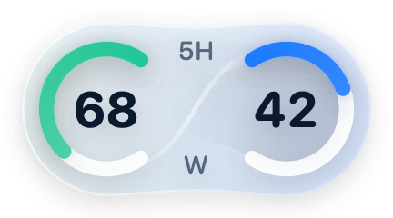
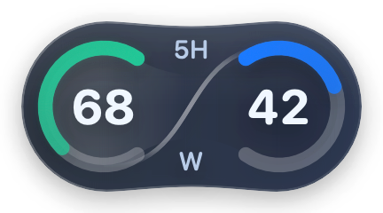

# Pet's Pet 1.2.2

日期：2026-10-16。基于已通过一轮真实重启验收的 1.2.1，修复卡片遮挡、拖动跟随延迟和中央标签顺序。

## 版本图片

| 额度组件 · 浅色 | 额度组件 · 深色 |
| --- | --- |
|  |  |

中央标签在本版调整为上 5H、下 W；位置避让及跟随结果见正文验收记录。图片分别取自本版留档预览及匹配源码包中的深色预览，均为原生组件评审图；历史样本 68／42 按原图保留，不是实机截图或当前账号数据。图片来源与原文件校验值见[图片归档说明](Images/README.md#v122)。

## 用户可见变化

- 避让范围包含完整任务卡片和操作条，默认居中放在整组内容下方，下方不足时放到整组上方；上下都放不下时隐藏，避免挤入卡片。
- 将结构检测与位置读取分开。独立位置队列以约 60Hz 为目标，只读取已确认宠物的位置；主线程只保留最新待处理坐标，移动面板时不重复布局。该频率是调度目标，实际读取速度由系统与 Codex 响应决定。
- 中央标签改为上方 5H、下方 W。左侧绿色仍对应 300 分钟额度，右侧蓝色仍对应 10080 分钟额度，不交换数据。

## 实现文件

- `Sources/PetsPet/PetMonitor.swift`：完整容器识别、独立位置读取、旧连接结果失效、运行诊断。
- `Sources/PetsPet/Overlay.swift`：中央标签、面板移动。
- `Sources/PetsPet/AppDelegate.swift`：减少重复界面更新，记录位置读取频率和耗时。
- `Sources/PetsPetCore/Anchor.swift`：展开卡片的完整边界。
- `Sources/PetsPetCore/LatestValue.swift`：线程安全的最新值交付。
- `Tests/PetsPetCoreTests/PetsPetCoreTests.swift`：两张反馈截图几何、展开卡片、慢消费及并发交付检查。
- `Resources/Info.plist`、网页预览、README 与版本日志。

## 验证与边界

- 26 组、134 项断言通过，包括既有重启恢复、额度周期映射、错误／空值状态与新增位置和坐标交付检查。
- 生产候选构建通过；浅色、深色及异常状态预览由实际 SwiftUI 视图生成。
- 真实桌面拖拽流畅度、实际卡片避让和本版 Codex 重启回归尚未验收。几何检查和调度目标不能替代实际体验。
- 本版延续本机临时签名，系统可能要求重新添加辅助功能授权。未改动 Codex 文件、系统授权或用户登录信息。

## 桌面验收

1. 更新并确认辅助功能授权后，检查中央上方 5H、下方 W，左右真实数据与菜单一致。
2. 任务卡片出现在宠物上方和下方时，组件均应位于整组内容外；下方空间充足时优先下方。
3. 连续拖动宠物，检查跟随是否流畅；诊断记录实际位置读取频率及耗时，不只看设定频率。
4. 当前任务结束后再重启 Codex，检查组件能否自动恢复；保留 1.2.1 的历史包。

## 发布后反馈

- 用户确认标签顺序正确，并反馈下方展开卡片状态的间距正确。
- 收起后与宠物间距过大，上方模式也存在额外空白，继续在 1.2.3 修复。
- 当前运行诊断记录约 60Hz 的位置读取；这只能证明读取频率，不代表拖拽手感已经由用户验收。
