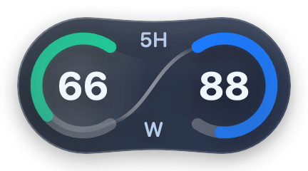
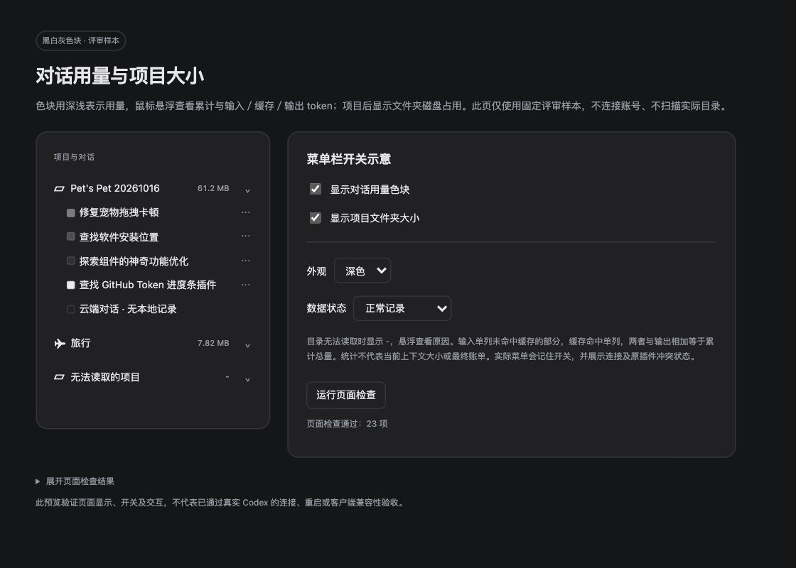

# Pet’s Pet 1.3.0

日期：2026-10-17。内部构建号：15。同版本修复已合并，不新增发布版本。独立保留本版最终安装包与匹配源码包，1.2.3 留档保持不变。

## 版本图片

| 额度组件 · 浅色 | 额度组件 · 深色 |
| --- | --- |
|  |  |

侧栏功能的开发阶段评审留图：

额度图取自 GitHub 本版最终发布预览和匹配的公开源码包，演示值为 66／88。侧栏图取自同一源码包中的评审页面留图，含开发阶段固定样本，图中目录数值保留当时样本；最终十进制统计口径以正文为准。以上分别为原生组件评审图与评审页面截图，不是实际 Codex 侧栏截图，也不代表当前账号数据。图片来源与原文件校验值见[图片归档说明](Images/README.md#v130)。

## 新增与调整

- 对话前显示黑白灰用量色块，浅色界面用量越高越深，深色界面越高越亮。悬浮展示累计用量、输入（未命中缓存）、缓存命中、输出 Token；不再显示重复的精确记录。明细缺失或与总量不一致时保留真实总量并说明状态，未知用量不显示假零值。
- 本地项目后按 Finder「大小」统计文件内容字节，包含隐藏文件、构建缓存及应用包内容；硬链接逐项计入，符号链接只计自身长度，不重复扫描链接目标。按十进制 KB／MB／GB 换算，百兆以上保留一位小数，悬浮显示精确字节和缓存说明；读取中显示 `…`，无法读取时显示 `-`。后台限流、超时与缓存避免重复扫描大目录。
- 菜单新增「显示对话用量色块」「显示项目文件夹大小」，首次默认开启，分别保存用户选择。
- 侧栏模块采用本项目独立实现，通过本机调试连接按页面元素与对话 ID 显示；没有其他插件的冲突检测与兼容分支，不按屏幕位置覆盖侧栏。
- 单击宠物本体可切换额度组件，菜单显示相同开关；允许不超过 4 点的轻微手抖，按下时使用已经确认的宠物窗口判断遮挡，避免点击动画与异步命中测试竞争。超过 4 点的拖拽即使移回原位、长按和点击旁边卡片均不触发切换。诊断补充点击切换或拒绝原因。
- 恢复菜单栏「启用侧栏连接…」：用户点击并确认后，才请求 Codex 正常退出并带本机调试参数重新打开。取消、退出被拒绝或等待 20 秒仍未退出时取消，不强制结束；复用用户已自行重开的实例。
- 去掉断连后每 5 秒自动检测的循环。启动、开关变化、Codex 进程变化和睡眠恢复只检查一次；失败或连接中断后停止，等待用户手动连接。已连接后的用量、侧栏行和目录统计仍约每 5 秒正常刷新；手动重开后仅限时等待约 20 秒就绪。睡眠、关闭全部侧栏功能或退出会取消连接流程。
- 宠物静止时每秒检测，拖拽期间按需提高位置跟随频率，停止拖拽后恢复低频；高频阶段暂停完整结构扫描。
- 微调太极曲线纵向衔接，使其经过两端轨道端面中心，保留横向走势与组件尺寸。

## 主要文件

- `Sources/PetsPetSidebar/`：侧栏显示、本机通信、只读 Token 统计、明细缓存与目录统计。
- `Sources/PetsPet/SidebarController.swift`、`AppDelegate.swift`：菜单、设置持久化与连接生命周期。
- `PetClickMonitor.swift`、`PetMonitor.swift`、`TrackingCadence.swift`、`Overlay.swift`：点击、跟随与曲线调整。
- `Tests/`、`Previews/`、构建脚本、版本配置和说明。

## 验证

- 核心检查 43 组、239 项断言通过；侧栏检查 61 项断言通过，覆盖明细校验、缓存、截断写入、读取预算、路径限制、目录统计及隔离本机 HTTP／WebSocket 通信。
- 新增真实侧栏控制器生命周期 19 项隔离断言通过，验证首次失败只查一次、生命周期失败不启动轮询、连接后继续刷新、断连后停止、睡眠／关闭功能／退出后停止，以及开关保存；不操作真实 Codex 的启动和退出。
- 两个真实项目的统计字节与独立逐项读取完全一致；其中一个验收目录为 653,924,734 字节，与同一时刻 Finder 结果一致。覆盖空目录、隐藏文件、硬链接、符号链接、稀疏文件、多根目录、权限失败、取消及超时。Pet’s Pet 的构建及测试会改变目录总量，对比需使用同一时刻的值。
- 发布工具 7 项测试通过；完整正式源码编译通过。发布流程校验本地签名、安装包内容、源码版本与 SHA-256，校验成功后才替换同版本最终留档。本次按用户要求打包，并在用户自行退出组件后校验更新固定入口；不自动退出或重新打开应用。
- 原生曲线预览的六处端面中心误差小于 0.001 点。
- 网页评审页 32 项检查通过，覆盖十进制大小边界、统计口径说明、原有独立开关、过期状态和元素清理。隔离检查不能代替真实 Codex 联调。

## 使用与待验收

- 本次打包留档并在用户自行退出组件后替换固定入口，用户自行安装和重开 Pet’s Pet。安装包构建与验证不退出或重启 Codex。
- 本工具不能在已运行且未开放调试入口的 Codex 上补开入口。需要用户从菜单点「启用侧栏连接…」并确认后，正常重开 Codex；断连时不再循环检测。实际菜单取消、正常退出、拒绝／超时不强制结束、限时等待连接和重开后的显示均需安装新版后验收。
- 待实际客户端验收：Token 与本地记录核对，滚动／折叠／重命名，多窗口，两个开关跨启动保持，缺失目录显示 `-`，断连／睡眠恢复与退出清理。
- 点击交互、桌面拖拽流畅度及 CPU／内存／耗电变化、跨屏与曲线实际合成效果尚未实测。
- 本版使用本地临时签名，未做 Apple 公证；系统若不再认可原辅助功能授权，需要由用户为固定入口重新授权。
