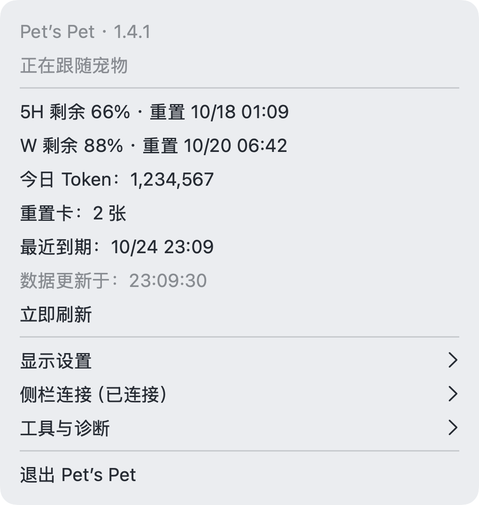

# Pet’s Pet 1.4.1

日期：2026-10-17。内部构建号：17。本版为本地交付，保留独立安装包、匹配源码、更新说明、预览和 SHA-256 校验文件；1.4.0 及更早版本留档保持不变。

## 新增与调整

- 菜单栏新增「今日 Token」，放在重置卡之前。通过 Codex 官方 `account/usage/read` 读取账号每日 Token 总量，独立于侧栏连接和对话累计用量。
- 主菜单按额度／倒计时、周额度、今日 Token、重置卡、最近到期、数据更新时间、立即刷新的顺序排列。
- 开关、组件内容和外观归入「显示设置」；侧栏状态与手动连接归入「侧栏连接（已连接／未连接）」；权限、重新检测和诊断文件夹归入「工具与诊断」。
- 每日统计与额度分别读取，单项失败不影响另一项。缺失、失败和过期数据保持未知状态，只有官方明确返回 0 时才显示 0。
- 菜单打开期间更新读取结果和连接状态；显示模式与外观设置继续保存。原有双圆组件外观保持一致。

## 演示素材

以上为程序绘制的菜单布局示意，使用与应用相同的数据行格式；不是实机截图。固定样本为 5H 剩余 66%、W 剩余 88%，Token 数量仅供演示。浅深组件及倒计时展示复用已核对的原生评审图片。

## 修改文件

- `Sources/PetsPet/AppDelegate.swift`：菜单分组、每日统计刷新与状态展示。
- `Sources/PetsPet/QuotaClient.swift`、`Sources/PetsPetCore/DailyTokenUsage.swift`：只读查询及每日统计解析。
- `Sources/PetsPetCore/QuotaMenu.swift`、`Sources/PetsPet/SidebarController.swift`：数据行顺序和菜单状态更新。
- `Tests/PetsPetCoreTests/PetsPetCoreTests.swift`、`Tools/Preview.swift`、`Previews/`：规则验证与简版预览。
- `Resources/Info.plist`、`README.md`、`Docs/DEVELOPMENT.md`、`Releases/`：版本及交付说明。

## 验证

- 54 组核心检查、417 项断言，侧栏 61 项、连接生命周期 19 项断言通过，共 497 项。覆盖真实零值与缺数据、非法日期、重复日期、负数、越界、过期、跨日及菜单顺序。
- 完整正式源码编译通过；真实读取模块已只读取得本机账号当日统计和额度数据，未发起模型任务。
- 发布工具的 8 项检查通过。
- 发包流程校验本地签名、版本、独立安装包、匹配源码和 SHA-256；固定入口仅在应用已退出后更新。

## 待实机验收与限制

- 官方未说明每日统计的日界线时区；菜单按本机日期选取同名官方统计日，悬浮提示注明统计日期和口径，统计可能延迟。无当日数据时显示暂不可用，不用昨天数据或对话累计值代替。
- 预览自动查看被浏览器安全策略阻止，网页视觉效果尚未核验。用户自行打开新版后，需验收原生菜单排布、子菜单点击与状态更新。
- 真实 Pro 账号、多屏、快速拖动、睡眠恢复和跨系统／客户端版本兼容性仍需实机验收。
- 本版面向 Apple Silicon Mac，使用本地临时签名，尚未做 Apple 公证；辅助功能授权由系统与用户管理。
