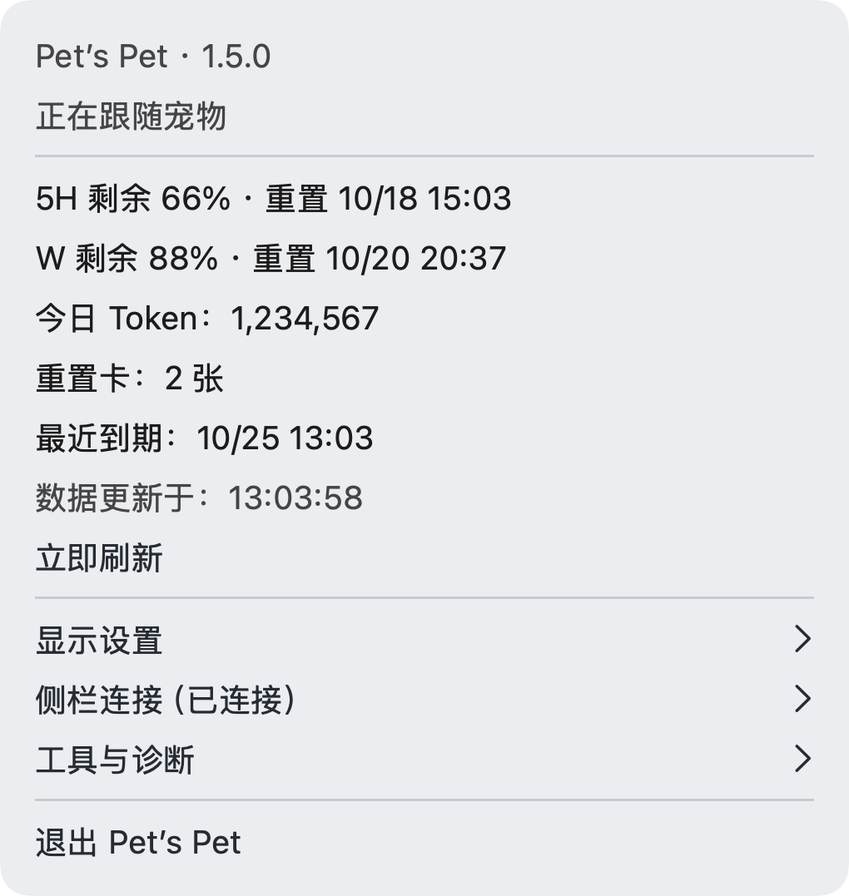
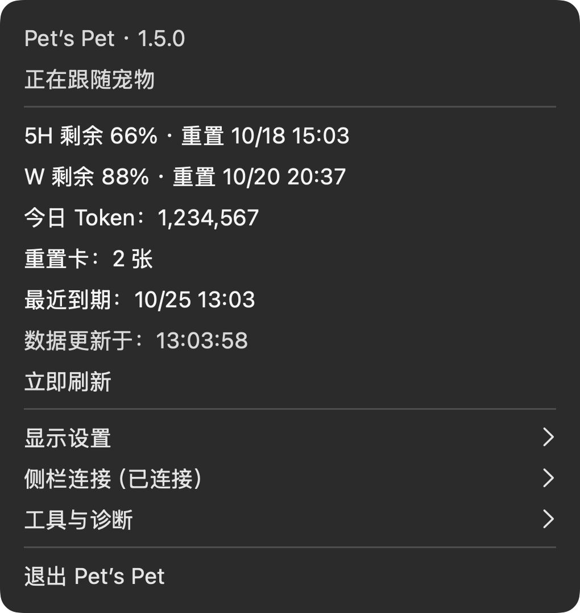

# Pet’s Pet 1.5.0

日期：2026-10-18。内部构建号：19。本版发布到 GitHub Releases；保留独立安装包、匹配源码、更新说明、原生组件预览及 SHA-256 校验文件。同版本修订替换原构建 18 的最终安装包和源码留档。

## 本次修复

- 今日 Token 在更新累计统计基线前识别非连续重复事件，避免实际 300 Token 被算成 400；增量读取仍保留去重结果。无法确认的乱序或计数回退标为“部分”。
- 多目录项目保留明确选入的链接目录，解析真实路径后再去重，避免漏算外部目录；明确选入的目录失效时显示读取失败，不将部分大小当作完整合计。
- 本地发布安装脚本改为整体替换应用，清除新版本已移除的旧资源。替换、签名或校验失败时恢复旧包；回滚失败也保留旧包并提示恢复位置。
- 本轮不改变界面，首页和下载页继续复用本版已核对的组件与位置演示图。

## 新增与调整

- 「显示设置 → 显示位置」新增跟随宠物（默认）和侧栏底部，选择会保存，重开后保留。
- 固定模式下，组件在侧栏内水平居中，主体底边与左侧头像底边对齐。不增加独立底板，整体以 78% 不透明度悬浮在聊天列表上；保留列表底部的透明滚动留白，最后一条聊天可以继续滑到组件上方。鼠标事件穿透组件。
- 固定模式不依赖宠物显示，暂停宠物位置和点击监听；切回跟随模式后恢复原有跟随与点击收起／展开。组件内容、外观及显示开关继续共用。
- 固定组件、对话用量色块、项目大小分别控制。固定模式需要原有本机侧栏连接；断连后提示状态，不因额度刷新自动重启 Codex。手动启用连接仍需用户点击并确认。
- 今日 Token 改为本机自然日 0 点至今已记录的输入＋输出，包含缓存且不重复计数；本机跨日、时区和夏令时按日历处理。记录不完整时标注“部分”或显示暂不可用，不将缺失数据算作 0。
- 主菜单只读信息文字加深，提升额度、Token、状态和时间的可读性。

## 版本图片

| 侧栏底部 · 浅色 | 侧栏底部 · 深色 |
| --- | --- |
|  |  |

| 额度组件 · 浅色 | 额度组件 · 深色 |
| --- | --- |
|  |  |

| 菜单布局 · 浅色 | 菜单布局 · 深色 |
| --- | --- |
|  |  |

图片原样复用本版构建 18 时归档的素材，构建 19 没有界面变化。浅色位置图取自原版留档，深色位置图取自已公开的文档提交；组件与菜单图取自原版匹配源码包。以上为复用原生组件生成的布局示意、原生评审图片和程序绘制的菜单布局示意，不是实机截图；66／88 等固定值只用于演示，不改变真实额度读取。图片来源与原文件校验值见[图片归档说明](Images/README.md#v150)。

## 预览与验证

- 浅深色、额度／倒计时及异常状态沿用同一原生 `QuotaView`；位置预览图片通过正式的 2× 侧栏渲染器生成。图片仅含演示数值，5H 剩余 66、W 剩余 88，不改变真实读取。
- 布局预览见源码中的 `Previews/position.html`；可切换位置、内容、外观和侧栏宽度。预览脚本与应用共用，附有底边对齐、悬浮、滚动、鼠标穿透和清理检查。
- 54 组核心检查 423 项、侧栏 123 项、控制器生命周期 27 项、原生组件渲染 16 项断言通过，共 589 项；发布工具 10 项测试通过。新增检查覆盖非连续重复统计、增量去重、乱序与回退、明确选入的链接目录，以及安装替换和失败回滚。
- 打包流程使用当前源码隔离构建，校验本地签名、版本、安装包、源码快照和 SHA-256。固定入口仅在应用已退出后更新。

## 待实机验收与限制

- 原构建 18 的本机安装体验已获用户确认；本次构建 19 尚未完成用户打开后的实机验收。位置选择重开保存、多窗口、跨屏、快速拖动及睡眠恢复等完整组合仍需逐项实机验收。
- 网页自动读取受浏览器安全策略限制，页面自动化检查未完成；其他客户端版本、窗口最小化／恢复、多窗口、跨屏和睡眠恢复尚未全面验收。本机侧栏结构变化可能需要适配。
- 今日 Token 来自本机可读的统计记录，不承诺等于官方计费账单；记录缺失、权限不足、统计格式不支持或未完成扫描时保守展示已确认部分。
- 面向 Apple Silicon Mac，使用本地临时签名，尚未做 Apple 公证。跟随宠物模式继续需要系统辅助功能权限；固定模式需要用户启用侧栏连接。

## 主要修改

- `Sources/PetsPet/AppDelegate.swift`、`SidebarController.swift`、`SidebarQuotaRenderer.swift`：位置菜单、独立连接、原生组件呈现与生命周期。
- `Sources/PetsPetCore/ComponentPosition.swift`、`Sources/PetsPetSidebar/Sidebar.js`：位置偏好、悬浮布局、滚动留白与清理。
- `Sources/PetsPetSidebar/LocalDailyUsage.swift`、`UsageDetails.swift`、`Sources/PetsPetCore/DailyTokenUsage.swift`、`Sources/PetsPet/QuotaClient.swift`：本机自然日统计及菜单数据来源。
- 对应 `Tests/`、`Scripts/`、`Tools/Preview.swift`、`Previews/`、版本资料和开发记录。

发布标签 `v1.5.0` 随本次同版本修订更新到最终源码提交；安装包、匹配源码、清单与 SHA-256 同步替换。源码提交与文件逐一核对结果记录在发布清单中，不保留同版本的多个构建分支。
