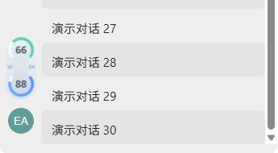

# Pet's Pet 1.6.0

日期：2026-10-23。macOS 内部构建号：20。本版新增 Windows x64 适配预览；macOS 功能和外观沿用 1.5.0，仅同步版本号与安装包。

## 下载

| 平台 | 下载 | 状态 |
| --- | --- | --- |
| Apple Silicon Mac | [PetsPet-1.6.0.zip](https://github.com/Marwin-M/pets-pet/releases/download/v1.6.0/PetsPet-1.6.0.zip) | macOS 正式包；本地临时签名，未做 Apple 公证 |
| Windows 10/11 x64 | [PetsPet-Windows-1.6.0-x64.zip](https://github.com/Marwin-M/pets-pet/releases/download/v1.6.0/PetsPet-Windows-1.6.0-x64.zip) | Windows 预览包；未签名，需 .NET Framework 4.8 |

Windows 包是免安装便携版。解压到个人可写目录，先打开并登录 Codex Desktop，再双击 `PetsPet.exe`。不要在 ZIP 内直接运行，也不要放进 `Program Files`。详细步骤见 [Windows 说明](../Windows/README.md)。两个平台的包与校验文件都放在同一 GitHub Release；GitHub 自动生成的 Source code 不是可运行安装包。

## 本版变化

- Windows 版采用独立的 C# / Windows Forms 实现，提供 5H / W 额度、自动或手动显示模式、宠物跟随、独立浮窗和头像上方侧栏组件；包含深浅外观、尺寸调整及托盘操作。
- 宠物旁无安全摆放空间时，Windows 组件会隐藏；找到安全位置后恢复，不停留在旧位置。
- Windows 构建脚本生成 x64 EXE；发布流程检查版本、规则与渲染样本，再生成可下载 ZIP 和 SHA-256 校验文件。源码包包含 Windows 源码与构建流程，排除本机 EXE、设置和验收截图。
- macOS 版不新增功能，继续使用 1.5.0 的组件与菜单设计。下方图示为沿用的原生评审素材，不代表 Windows 实际桌面截图。

| macOS 额度组件 · 浅色 | Windows 侧栏组件示意 · 浅色 |
| --- | --- |
|  |  |

两张图片均使用固定演示数据，左侧 5H 剩余 66、右侧 W 剩余 88；不读取展示者的真实账号额度。Windows 图片来自独立本地布局示意，尚不能当作实机截图。

## 验证与限制

- macOS 使用现有规则、侧栏与生命周期检查，并从当前源码隔离构建；安装包、签名、版本和源码快照由发布脚本校验。实际安装与打开仍需用户自行完成。
- Windows 发布流程在 Windows x64 构建环境编译，并运行 70 项规则断言、66 张渲染样本生成及压缩包内容校验。这些检查的最终结果以该版本构建记录为准。
- Windows 适配仅曾由贡献者在 Windows 11 x64、Codex `26.1016.6573.0` 环境验证。Windows 10、其他 Codex 版本、快速拖动、多屏混合缩放、遮挡和真实睡眠／唤醒仍需实机验收。
- Windows 版尚未移植今日 Token 汇总、对话 Token 色块与明细、项目文件夹大小；不承诺与 macOS 版功能相同。两端均依赖 Codex 客户端与账号状态，额度缺失或过期时显示未知，不以零代替。

源码来自合并的 Windows 适配 PR #2；感谢 [@Eason66887](https://github.com/Eason66887) 贡献首版实现。后续 Windows 改进欢迎继续通过 Issue 和 PR 一起维护。
