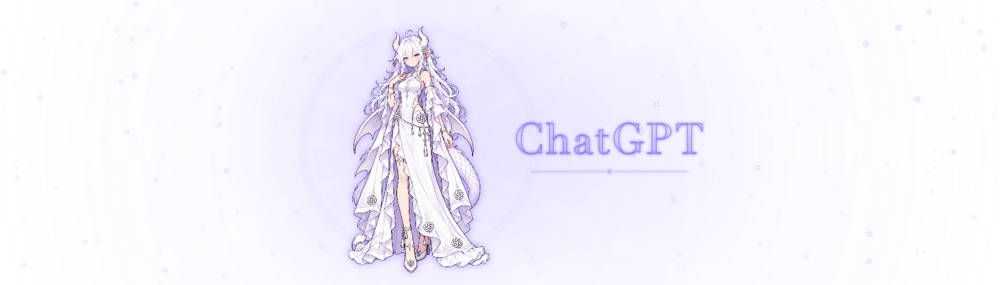

# Pet’s Pet 1.7.0

日期：2026-10-25。macOS 内部构建号：26。Windows 继续使用 1.6.0，不包含本次功能；可从 [Windows 下载页](https://github.com/Marwin-M/pets-pet/releases/tag/v1.6.0) 获取。同版本修改已合并为一份最终安装包和匹配源码。

## 本版变化

- 打开 Pet’s Pet 时可自动打开尚未运行的 Codex，默认显示以用户提供素材为基础的 10 秒动画。Codex 已运行则跳过开场，不重复启动或自动重启它。
- 启动素材支持单文件 HTML、MOV、MP4 和 PNG，可导入、应用内预览、更换或恢复默认动画。菜单统一使用「默认动画」「恢复默认动画」。实际启动时 HTML 与视频播放一次后保持末帧，不循环；视频静音，PNG 为静态画面。素材复制到本机数据目录，移动原文件后仍可使用。
- 修复 HTML 已加载但外层加载遮罩未刷新、始终只显示转圈的问题，覆盖自动启动 Codex 和预览两种入口。
- 预览增加画面右上角及菜单中的「结束预览」，加载中也可关闭。不再固定等待 15 秒：默认 HTML 在自身 10 秒结束信号后关闭，其他 HTML 按声明时长／结束信号关闭，MOV／MP4 在实际片尾关闭；PNG、未声明结束的 HTML 或加载失败提示由用户手动结束。
- 开场优先使用上次 Codex 主窗口的位置和尺寸，窗口就绪后校准。默认 HTML 保留自适应布局：人物、文字保持等比，修复宽屏下扩散光圈变椭圆的问题，光圈和光晕等比绘制、粒子和光效继续覆盖两侧。直接更新内置 HTML，不另生成动画副本。视频和 PNG 等比铺满、居中裁切，不拉伸变形；首次没有记录时按屏幕可用尺寸居中显示。
- 启动和预览背景增加系统毛玻璃，人物、文字与光圈保持清晰。客户端主界面可操作后，动画与毛玻璃一起用 0.8 秒渐隐；客户端先就绪则提前结束，动画先结束则保持最后一帧与模糊背景继续等待。遵循系统「减少动态效果／降低透明度」设置，不使用截屏或修改客户端。
- 开场结束后恢复原有跟随／侧栏模式、显示与隐藏、外观及额度内容。新增「ChatGPT 退出时退出 Pet’s Pet」开关，默认开启并保存选择：目标客户端真正退出时一起正常退出；关闭后只隐藏组件，Pet’s Pet 留在菜单栏。单纯关闭窗口、最小化、隐藏或连接断开不触发，主动重连旧进程的退出不会误退。退出 Pet’s Pet 不会关闭客户端。
- 修复客户端退出后 Pet’s Pet 卡在退出确认、菜单残留且「启动 ChatGPT」被禁用的问题。退出请求交回原生事件循环处理；正常清理完成即退出，清理最长等待 2 秒，重复请求不再次进入退出流程。菜单退出和重复实例退出也使用统一入口，不强制结束或操作客户端。
- 「启动设置」新增「启动 ChatGPT」，目标仍为已确认的 Codex 客户端；手动点击时固定带上仅限本机的连接参数，已运行、正在启动或重连时不可点。手动操作不改变未来自动启动的授权选择，也不重启已有客户端。
- 首次可明确授权启动时恢复本机侧栏连接，后续沿用授权与侧栏开关；已有 Codex 缺少连接时仍需手动处理，不自动重启当前会话。
- 处理未安装、启动失败、提前退出、超时、素材损坏，以及睡眠／锁屏打断。素材导入失败保留原选择。

## 样式示意

以上来自修正光圈后的实际 WebKit 渲染，展示普通窗口和带鱼屏的动画末帧；只包含 HTML 前景，不包含窗口背后的系统毛玻璃，不是实际 Codex 冷启动截图，也不代表已完成多屏实机验收。安装包附带的 `preview.png` 使用普通窗口 HTML 渲染图。原额度组件沿用已有外观和已核对的 66／88 演示素材，不改真实额度读取。

## 验证与限制

- 本次通过核心规则 423、侧栏读取 123、每日 Token 33、侧栏生命周期 42、额度原生渲染 16、启动与退出 94 项检查，共 731 项；发布工具 10 项检查通过。生产构建与安装包、源码和资源校验随本次打包完成。
- HTML 与完整原生窗口专项此前 66 项通过。本次图形会话锁定、显示器休眠，WebKit 按系统规则暂停绘制，因此无法重跑这部分画面检查；已确认动画资源、网页播放器、原生动画窗口和布局源码与此前通过检查的构建 25 逐字节一致。
- 启动专项覆盖隔离启动时序、已运行跳过、失败／超时／取消、几何恢复、真实 HTML/PNG/MOV/MP4 导入与原生铺满渲染。HTML 专项检查真实 10 秒播放、透明背景、末帧保持、宽屏／竖屏自适应、脚本失败和外部请求禁止，另检查整个原生窗口确实移除加载遮罩、按动画时长关闭预览、加载中手动结束、快速完成、PNG 与加载失败可关闭、真实 MOV／MP4 片尾关闭及启动末帧保留；测试没有打开或退出真实 Codex，也不读取真实账号数据。
- 新增隔离检查覆盖手动启动的重复防护、参数与授权、客户端真正退出、主动重连旧进程排除；真实 WebKit 检查不同尺寸下入场和持续扩散光圈的等比绘制、两侧动效。原生窗口检查系统毛玻璃层级、范围、非激活状态、末帧保留及实际约 0.8 秒的统一渐隐。
- 另通过四个真实独立 AppKit 进程场景：正常清理实际执行并退出、清理不响应时按上限退出、开启跟随退出时结束进程，以及关闭开关时保留运行且仍能手动退出；均检查重复请求只处理一次。偏好设置测试覆盖默认开启、保存选择、取消待执行退出与重新开启。测试不会操作当前 Pet’s Pet 或真实客户端。
- 视频容器不代表所有编码都能播放，以本机解码能力为准。素材不超过 200 MB，PNG 宽高各不超过 4096 像素。
- “启动完成”需主窗口可见且主界面可操作：优先使用已授权的侧栏连接，确认文档、导航、可用输入区与主区域加载标记；无连接时尝试已有辅助功能权限中的网页区域与可用多行输入控件。缺少权限／连接、登录或无输入区界面、未来客户端结构变化时可能无法确认。最长等待 30 秒，失败和长时间无法确认时结束动画并提示，不将动画的 10 秒结束当作启动失败。
- 默认 HTML 仅在临时 WebKit 存储中运行，禁止联网及其他本地文件访问；读取、脚本或首帧异常会回退到原生 loading。透明背景包含受能力检测保护的 macOS WebKit 兼容处理，其他系统版本待实测。
- 真实 Codex 冷启动、手动启动和退出、主动重连、首次授权、实际毛玻璃观感、实际视频解码和过渡、多屏／全屏／空间切换、睡眠恢复仍需用户安装后验收，步骤见 [启动动画说明](../Docs/STARTUP.md)。
- macOS 安装包为 Apple Silicon、本地临时签名，尚未经过 Apple 公证。保留现有安装位置和辅助功能授权检查；不自动启动应用，不修改 Codex 安装文件。
