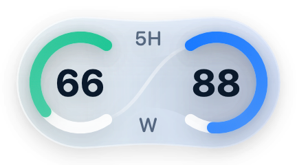
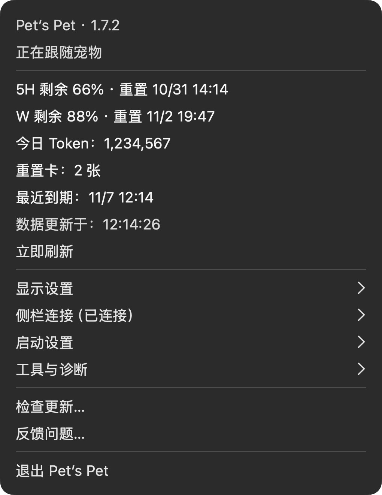

# 1.7.2 · 检查更新与问题反馈

日期：2026-10-31。macOS 内部构建 29；安装包、匹配源码、清单及 SHA-256 本地留档于 `dist/releases/1.7.2/`。尚未发布到 GitHub，Windows 继续使用 1.6.0。

## 用户可见变化

- 菜单增加「检查更新…」和「反馈问题…」。发现新版可前往本项目 GitHub 下载页查看说明、手动下载及安装；反馈页只预填应用版本、构建号和 macOS 版本。
- 自动检查成功后每天检查一次；网络、服务器或数据错误后约 15 分钟重试，恢复网络后不再等待整天。失败不会显示为已是最新。
- 公开版本号相同时读取现有发布附件 `manifest.json`，校验应用标识、版本和构建号，支持 1.7.1 构建 27 → 28 这类修订。清单缺失、错误或无法读取时明确提示无法确认；不会使用安装包大小或发布日期猜测构建。
- 更新结果在锁屏、启动动画、菜单或其他弹窗显示期间保留，恢复可显示状态后补发；实际显示后才标记为已提醒。同一构建不重复自动提醒，手动检查仍有结果。
- 保留现有额度、Token、侧栏、明暗动画及短配乐。中英文说明均纳入匹配源码包。

## 验证与限制

核心 58 组／466 项断言、侧栏 123、每日 Token 33、侧栏生命周期 42、更新检查 38、额度渲染 16、启动逻辑与素材 116 项，共 834 项断言通过；另有 4 个真实独立 AppKit 退出场景及 10 项发布工具检查通过。更新检查使用真实 URLSession 与隔离 HTTP 响应、偏好及时钟，覆盖成功／失败、15 分钟重试与持久化、同版本构建、清单身份与缺失、重复请求、取消及暂缓通知。没有操作真实客户端的退出、启动或账号。

真实 GitHub 只读联网验证通过：从公开最新版本元数据定位 `manifest.json`，实际识别 1.7.1 构建 27 → 构建 28。没有依靠测试样本冒充线上返回，也没有上传数据。

发布模式源码编译通过。留档流程校验签名、压缩包、应用与源码的版本／构建号、可执行文件和 SHA-256，一致后才保存最终安装包；固定入口由独立安装步骤更新，用户自行退出及重新打开应用。

原生 HTML／开屏检查在本轮出现加载状态及首帧音画 250 毫秒判定失败，不计入通过项。使用上一已发布提交的原始启动源码、资源和测试作独立对照，旧版本也在同一原生展示阶段失败；本轮没有修改动画、音频或播放器来规避测试。实际原因尚未定位，已安装应用的加载及音画同步仍需用户实机验收。日志分别为 `.build/1.7.2-remaining-checks.log`、`.build/1.7.2-html-recheck.log`、`.build/1.7.1-baseline-html.log`。

GitHub 发布清单沿用现有 `version`、`build`、`bundleIdentifier` 字段；未来公开发布需要继续上传 `manifest.json`。旧版 Pet’s Pet 没有本次功能，不能依靠本次改动自动为旧版补上更新提醒。

本地临时签名，Apple Silicon，最低声明 macOS 13，尚未做 Apple 公证；其他 Mac、真实锁屏／睡眠、多屏及用户实际安装后的菜单交互仍需实机验收。

手动验收：用户自行打开新版后，选择「检查更新…」，应显示当前 1.7.2／构建 29 及检查结果；断网时应显示失败而非最新，恢复后可手动重试。选择「反馈问题…」应只打开反馈页并带版本信息，不自动提交。未来有可用新版时，检查期间锁屏／播放开屏／打开菜单后，提醒应等待恢复再出现，同一构建不重复自动弹出。

## 界面示意

| 浅色 | 深色 |
| --- | --- |
|  |  |
|  |  |

额度图复用已核对的原生组件图，固定演示剩余 66／88；菜单图为本次原生绘制的布局示意。均不代表真实账号用量或运行中的客户端截图。
