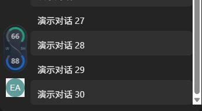

# Windows 适配版（预览）

独立的 C# / Windows Forms 实现，为 Windows 版 Codex Desktop 提供额度组件。代码位于本目录，不参与原有 Swift 构建，也不修改 Codex 安装文件。这是有限范围的适配，尚未达到 macOS 版的全部功能。

## 运行

需要 Windows 10/11 **x64**、.NET Framework 4.8，以及已安装并登录的 Codex Desktop。当前仅在 Windows 11 x64、Codex `26.1016.6573.0` 上验证；Windows 10 和其他客户端版本仍待验证。程序需要可写目录来保存设置和诊断，不要放入 `Program Files`。目前没有签名或 Windows 发布安装包。

在仓库根目录打开 PowerShell，执行：

```powershell
# 将源码生成本目录下的 PetsPet.exe；不安装系统服务或全局工具
powershell -NoProfile -ExecutionPolicy Bypass -File .\Windows\build.ps1

# 启动；之后可直接双击 Windows\PetsPet.exe
Start-Process -FilePath .\Windows\PetsPet.exe
```

`ExecutionPolicy Bypass` 只作用于这一次 PowerShell 进程，不更改系统设置。构建使用 Windows 自带的 .NET Framework C# 编译器，无第三方运行时依赖。重新生成前，请从本目录程序的托盘菜单选择“退出”。

先正常打开 Codex，再打开 PetsPet，以便识别客户端的安装位置和服务组件。额度读取使用 `CODEX_HOME` 指定的目录，否则使用当前用户的 `.codex` 目录；如有自定义目录，应让 PetsPet 继承同样的 `CODEX_HOME`。它是一个环境变量，即传给程序的配置值。程序还会保存到 `data/settings.json`，其中的 `codexHome` 可在退出程序后修改。

## 功能与操作

| 功能 | Windows 行为 |
| --- | --- |
| 额度与自动模式 | 从 Codex 随附的官方 App Server 读取；有 5H 时显示 5H / W 剩余百分比，只有周额度时显示重置剩余天数 D / W。也可手动选择 |
| 外观 | 沿用原版相向 C 环、连接曲线、128×64 主体比例与深浅配色；仅官方返回 Pro 套餐时显示 PRO 底纹 |
| 跟随宠物 | 默认位置；单击 Codex 宠物收起／展开组件，拖动不切换。快速拖动期间提高位置更新频率 |
| 鼠标穿透 | 可在托盘菜单开关；Windows 默认关闭，可右键组件设置、双击打开详情。开启后点击传给下方窗口，设置从托盘进入 |
| 侧栏位置 | 竖向 64×128，在左侧账号头像上方居中，保留 10 个界面像素间隔；数字正向、始终穿透，不遮挡聊天列表。空间不足或头像不可见时隐藏 |
| 独立浮窗 | 可直接拖动额度组件，位置会保存 |
| 大小与主题 | 详情页调整 50%～200%，默认 100%；侧栏超出导航栏宽度时等比例缩小。支持浅色、深色、跟随系统 |
| 恢复 | 包含多屏边界摆放、显示器变化重定位、睡眠暂停与唤醒恢复逻辑；真实硬件场景仍待完整验收 |

单击托盘图标打开详情，右键打开菜单。关闭详情后继续在后台运行；从托盘“退出”完全结束。重复启动只打开已有实例的详情。

图标复用原仓库资源：`assets/AppIcon.ico` 由 `Resources/Artwork/AppIcon.png` 转换为 Windows 多尺寸格式；托盘图标在构建时直接嵌入 `Resources/MenuBarIcon.png`。没有重新绘制图标。

### 连接侧栏

跟随宠物和独立浮窗不需要侧栏连接。侧栏位置通过本机调试接口 CDP（客户端页面的调试连接）接入，流程如下：

1. 保持 PetsPet 运行，**手动完全退出 Codex，包括后台进程**。只关闭当前窗口可能没有退出。
2. 从 PetsPet 详情点击“连接侧栏”，或托盘选择“启用侧栏连接…”。
3. 确认后，由 PetsPet 带连接参数打开 Codex；不要同时从普通快捷方式打开。

连接有效时直接复用。后台未退出时只提示流程，不自动关闭窗口、不强制结束进程。启动后最多检测 30 秒，可取消检测；取消不会关闭 Codex。客户端升级导致记住的路径失效时，先正常打开新版一次，再按上述流程连接。

只连接 `127.0.0.1:39222`，不安装启动助手、不改变 Codex 默认启动方式。该接口提供本机页面调试能力，仅在需要侧栏模式时启用。普通重开 Codex 后，可能需要重新按上述流程启用。已建立连接时每约 2 秒更新显示；脚本在退出、禁用或失联约 15 秒后清理自己的元素。此行为与原版的连接生命周期并非完全一致。

| 浅色侧栏 | 深色侧栏 |
| --- | --- |
|  |  |

图片来自独立本地验收页面，使用固定演示数值 66 / 88，不是实际 Codex 截图或账号额度。

## 数据与限制

额度通过 `account/rateLimits/read` 每约 60 秒读取，`account/read` 补充套餐类型。复用 Codex 已有登录，不需要 API 密钥，不读取或保存登录凭据，不发起模型任务。缺失、失败或超过 150 秒的数据显示 `--`，不以零代替未知。

原生跟随读取系统辅助功能提供的宠物标识与位置；鼠标监听不消费原有点击事件。侧栏脚本只定位导航栏、头像等布局元素，不采集对话正文。设置、诊断和用户主动保存的截图写在本目录 `data/` 和 `验收截图/`，不会自动上传。这些本机文件不进入代码仓库。

本次没有移植：今日 Token 汇总、每段对话累计 Token 色块和输入／缓存／输出明细、项目文件夹大小。Token 是模型计算文本用量的单位，不等同于字数或剩余额度。Windows 托盘替代 macOS 菜单栏，权限和打包流程也不同。

客户端内部页面结构或宠物标识变化可能导致定位失败。**快速拖动、多屏混合缩放、负坐标副屏、遮挡和真实睡眠／唤醒仍需进一步实机验收**。规则检查不能替代这些场景；没有验证 macOS 编译或运行行为。当前 Windows 可执行文件未签名。

## 开发检查

仓库根目录执行：

```powershell
powershell -NoProfile -ExecutionPolicy Bypass -File .\Windows\build.ps1

# 固定数据规则检查，不查询账号或操作 Codex 页面
$checkProcess = Start-Process -FilePath .\Windows\PetsPet.exe -ArgumentList '--self-test' -Wait -PassThru
if ($checkProcess.ExitCode -ne 0) { throw '规则检查失败，请查看 Windows\data\self-test.json' }
Get-Content -LiteralPath .\Windows\data\self-test.json

# 生成深浅色、不同大小与状态的固定视觉样本
$renderProcess = Start-Process -FilePath .\Windows\PetsPet.exe -ArgumentList '--render-checks' -Wait -PassThru
if ($renderProcess.ExitCode -ne 0) { throw '样本生成失败' }
Get-Content -LiteralPath .\Windows\data\render-checks.json
```

`--self-test` 目前有 69 项断言，覆盖额度解析、未知／过期、模式选择、单击／拖动区分、摆放边界、图标、鼠标穿透、本机地址限制、手动退出连接流程、取消与竖向尺寸。`--render-checks` 生成 66 张样本到 `Windows/验收截图/视觉样本/`，需人工查看图形和文字。

如果已安装 Node.js 18 或更新版本（仅开发检查需要），生成样本后执行：

```powershell
node .\Windows\checks\sidebar-fixture.mjs
```

在浏览器打开打印的本机地址，点击“运行侧栏检查”。15 项页面检查覆盖头像定位、间距、比例、穿透、不遮挡聊天列表、折叠／隐藏恢复、缩放、图片地址限制和退出清理。页面使用正式 `Sidebar.js`，但不操作真实 Codex。按 `Ctrl+C` 停止本地服务。

可选通信模拟：仅在 `39222` 端口空闲、真实侧栏连接已关闭时，给上述命令加 `--cdp`，再运行 `PetsPet.exe --sidebar-check`。不要对真实 Codex 连接运行此检查，它会安装并清理模拟组件。

其他诊断：`--sidebar-status` 只读检查进程、安装路径和连接入口；`--probe-pet` 只读检查宠物位置；`--smoke-test` 查询真实账号额度。结果写入 `data/`；包含本机信息和真实数值的结果不要直接提交。

## 文件

- `PetsPet.cs`：额度服务、窗口、绘图、跟随、设置及规则检查。
- `Integration.cs`：点击监听、图标、本机侧栏通信与启动流程。
- `Sidebar.js`：头像上方组件定位、更新与清理。
- `build.ps1`、`app.manifest`：生成程序及普通用户权限、屏幕缩放声明。
- `checks/sidebar-fixture.mjs`：使用固定数据的本地页面和可选模拟接口。
- `assets/`、`previews/`：Windows 格式图标和固定数据布局示意。
